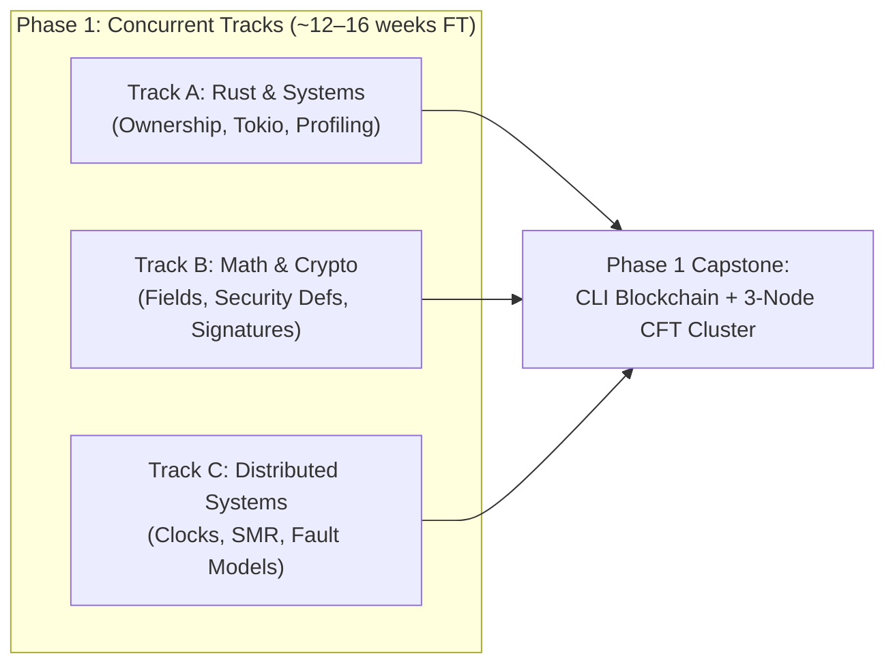
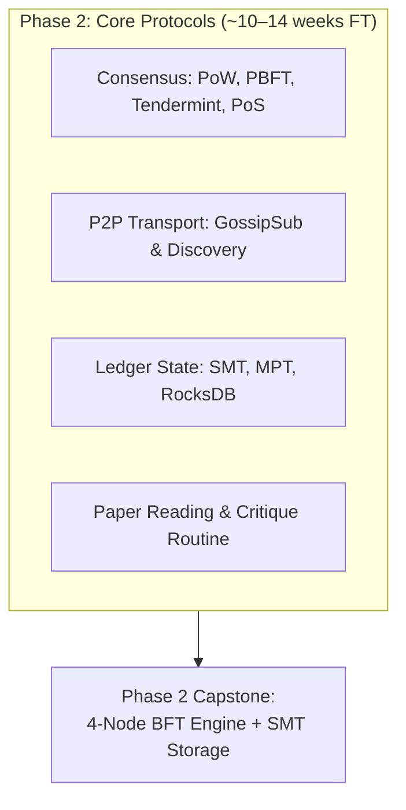
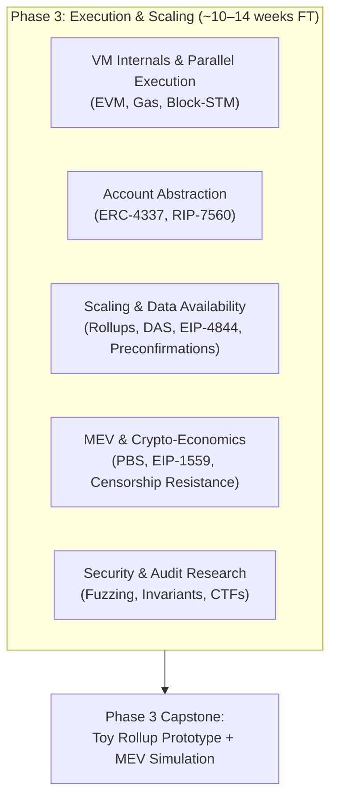
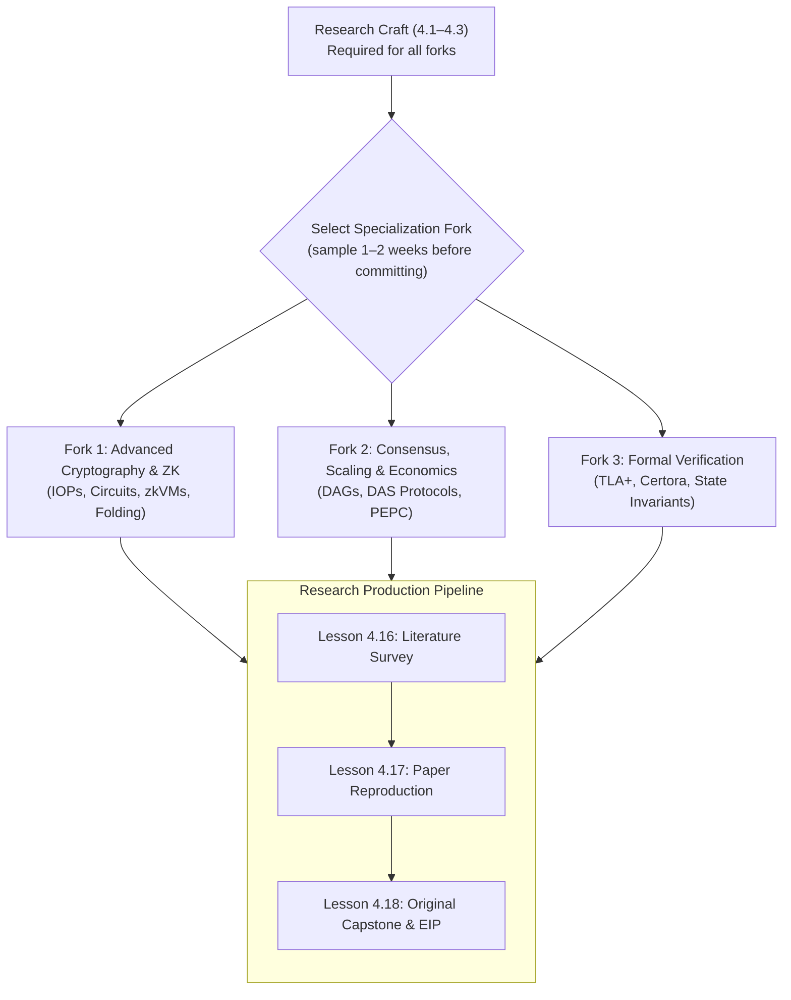

# Blockchain Research Curriculum: Step-by-Step Lessons

This curriculum breaks down [roadmap.md](file:///home/nulL/Documents/reshard/roadmap.md) into concrete, actionable lessons. Each lesson contains theoretical foundations, required readings/papers, hands-on implementation labs, and researcher self-check questions.

> **Language Requirements:** Labs use **Rust** (primary), **Python** (simulations & modeling), and **Solidity + Foundry** (smart contract security, from Phase 3 onward). Ensure working proficiency in all three before beginning.

> **Estimated Total Duration:** ~12–18 months full-time | ~2–3 years part-time (with a strong CS/math undergraduate background).

---

## Curriculum Structure Overview

* **Phase 1: Foundations (Concurrent Tracks)** — *~12–16 weeks FT*
  * [Track A: Systems Programming & Tooling](#track-a-systems-programming--tooling-lessons-11--14) (Lessons 1.1 – 1.4)
  * [Track B: Mathematics & Cryptography](#track-b-mathematics--cryptography-lessons-15--19) (Lessons 1.5 – 1.9)
  * [Track C: Distributed Systems & Fault Tolerance](#track-c-distributed-systems--fault-tolerance-lessons-110--114) (Lessons 1.10 – 1.14)
  * [Phase 1 Capstone Milestones & Gate](#phase-1-capstone-milestones)
* **Phase 2: Core Protocols & Ledgers** — *~10–14 weeks FT*
  * [Consensus Protocols & Proof of Stake](#consensus-protocols--proof-of-stake-lessons-21--24) (Lessons 2.1 – 2.4)
  * [Peer-to-Peer Networking & Transport](#peer-to-peer-networking--transport-lessons-25--26) (Lessons 2.5 – 2.6)
  * [State & Authenticated Storage Structures](#state--authenticated-storage-structures-lessons-27--29) (Lessons 2.7 – 2.9)
  * [Seminal Paper Reading Routine](#seminal-paper-reading-routine-lesson-210) (Lesson 2.10)
  * [Phase 2 Capstone Milestones & Gate](#phase-2-capstone-milestones)
  * [🚀 Escape Velocity](#-escape-velocity)
* **Phase 3: Execution, Scaling & Economics** — *~10–14 weeks FT*
  * [Virtual Machines & Parallel Execution](#virtual-machines--parallel-execution-lessons-31--33) (Lessons 3.1 – 3.3)
  * [Account Abstraction](#account-abstraction-lesson-34) (Lesson 3.4)
  * [Scaling, Rollups & Data Availability (DA)](#scaling-rollups--data-availability-da-lessons-35--38) (Lessons 3.5 – 3.8)
  * [MEV, PBS & Mechanism Design](#mev-pbs--mechanism-design-lessons-39--312) (Lessons 3.9 – 3.12)
  * [Security Auditing & Vulnerability Research](#security-auditing--vulnerability-research-lessons-313--315) (Lessons 3.13 – 3.15)
  * [Phase 3 Capstone Milestones & Gate](#phase-3-capstone-milestones)
* **Phase 4: Advanced Specialization & Original Research** — *~16–24 weeks FT*
  * [Research Craft & Academic Foundations](#research-craft--academic-foundations-lessons-41--43) (Lessons 4.1 – 4.3)
  * [Specialization Fork 1: Advanced Cryptography & ZK](#specialization-fork-1-advanced-cryptography--zk-lessons-44--47) (Lessons 4.4 – 4.7)
  * [Specialization Fork 2: Consensus, Scaling & Mechanism Design](#specialization-fork-2-consensus-scaling--mechanism-design-lessons-48--411) (Lessons 4.8 – 4.11)
  * [Specialization Fork 3: Formal Verification & Protocol Modeling](#specialization-fork-3-formal-verification--protocol-modeling-lessons-412--415) (Lessons 4.12 – 4.15)
  * [Research Production Pipeline](#research-production-pipeline-lessons-416--418) (Lessons 4.16 – 4.18)
  * [Peer Review & Research Community Guidance](#peer-review--research-community-guidance)
  * [Final Diagnostic Exercises](#final-diagnostic-exercises)

---

# Phase 1: Foundations (Concurrent Tracks)

> **Estimated Duration:** ~12–16 weeks full-time | ~6–8 months part-time.
>
> **Execution Strategy:** Run Tracks A, B, and C in parallel. Spend ~35% of your time on Rust systems engineering, ~35% on Math & Cryptography, and ~30% on Distributed Systems.
>
> **Cross-Track Dependencies:** Track C Lesson 1.14 (BFT formal arguments) benefits from Track B's cryptographic commitment intuitions. Schedule Track B's Lessons 1.5–1.7 before or alongside Track C's Lesson 1.14.

---

## Track A: Systems Programming & Tooling (Lessons 1.1 – 1.4)

### Lesson 1.1: Rust Memory Model & Ownership for Protocol Engineers
* **Estimated Time:** 1–2 weeks.
* **Objective:** Master Rust's ownership, borrowing, lifetimes, and memory layout to write zero-copy, memory-safe protocol logic.
* **Core Concepts:** Stack vs. heap allocations, fat pointers (`&[T]`, `&str`), `Copy` vs. `Clone`, interior mutability (`Cell`, `RefCell`), memory layout of structs and enums (`#[repr(C)]`), zero-copy parsing.
* **Readings:**
  * *The Rust Programming Language* (Chapters 4, 10, 15).
  * *Rust for Rustaceans* (Jon Gjengset), Chapter 1 (Foundations) and Chapter 2 (Types).
* **Hands-on Lab:**
  * Implement a zero-copy byte serializer/deserializer for a custom transaction binary packet format using `nom` or byte slices without allocations.
* **Self-Check Questions:**
  * How does the memory layout of an enum change with discriminants and data payloads?
  * When would you choose `RefCell<T>` over `Mutex<T>` in a single-threaded protocol handler?

### Lesson 1.2: Concurrency & Multithreaded State in Rust
* **Estimated Time:** 1–2 weeks.
* **Objective:** Understand thread synchronization primitives, lock contention, and race-free state transitions.
* **Core Concepts:** `Send` and `Sync` marker traits, `Arc<Mutex<T>>` vs. `Arc<RwLock<T>>`, lock-free programming with atomics (`std::sync::atomic`), crossbeam channels, deadlock conditions.
* **Readings:**
  * *Rust for Rustaceans*, Chapter 3 (Designing Interfaces) & Chapter 8 (Concurrency).
  * *Rust Atomics and Locks* (Mara Bos), Chapters 1–3.
* **Hands-on Lab:**
  * Build a thread-safe in-memory transaction pool (mempool) with priority queues sorted by fee-per-byte, allowing concurrent insertions and chunked batch extractions.
* **Self-Check Questions:**
  * What is the cost of lock contention under 32 parallel threads attempting to acquire write locks on state?
  * What happens if an `Arc<Mutex<T>>` is panicked while holding a lock? What is lock poisoning?

### Lesson 1.3: Asynchronous Systems with Tokio
* **Estimated Time:** 1–2 weeks.
* **Objective:** Build event-driven networking and async pipelines for distributed peers.
* **Core Concepts:** Futures, Polling, `async/await`, Tokio runtime architecture (work-stealing threadpool), cooperative scheduling, async streams, backpressure, cancellation safety.
* **Readings:**
  * Official Tokio Tutorial (tokio.rs/tokio/tutorial).
  * *Mini-Redis* repository walkthrough.
* **Hands-on Lab:**
  * Implement a simple peer-to-peer TCP heartbeat protocol: nodes accept inbound connections, send periodic ping messages, measure RTT, and drop unresponsive peers with timeouts.
* **Self-Check Questions:**
  * What makes an async operation cancellation-unsafe, and what happens if a `tokio::select!` cancels a pending socket write?

### Lesson 1.4: Systems Profiling & Linux Diagnostics
* **Estimated Time:** 1 week.
* **Objective:** Diagnose performance bottlenecks in node workloads (CPU, I/O, memory, network).
* **Core Concepts:** System calls (`strace`, `lsof`), CPU profiling with `perf` and flamegraphs, memory profiling (`valgrind`, `heaptrack`), benchmarking with `criterion-rs`.
* **Readings:**
  * *Systems Performance* (Brendan Gregg), Chapters 1 & 3.
* **Hands-on Lab:**
  * Benchmark your transaction pool from Lesson 1.2 using `criterion-rs`. Generate a flamegraph under heavy insertion workloads and optimize memory allocations.
* **Self-Check Questions:**
  * How do you identify whether a node bottleneck is caused by disk sync (`fsync`), lock contention, or CPU cache misses?
  * When does borrowing cause cache misses, and how do you organize data for cache locality in high-throughput node loops?

---

## Track B: Mathematics & Cryptography (Lessons 1.5 – 1.9)

### Lesson 1.5: Discrete Mathematics, Number Theory & Finite Fields
* **Estimated Time:** 1–2 weeks.
* **Objective:** Master modular arithmetic, group theory, and finite field constructions necessary for elliptic curves and ZK proofs.
* **Core Concepts:** Divisibility, extended Euclidean algorithm, modular inverses, prime fields $\mathbb{F}_p$, field extensions $\mathbb{F}_{p^k}$, cyclic groups, generators, discrete logarithm problem (DLP).
* **Readings:**
  * *A Graduate Course in Applied Cryptography* (Boneh & Shoup), Chapter 2 & Appendix on Number Theory.
* **Hands-on Lab:**
  * Implement a finite field element struct `FieldElement
` in Rust from scratch supporting addition, subtraction, multiplication, and inverse using Fermat's Little Theorem / Extended GCD.
* **Self-Check Questions:**
  * Why must the modulus $p$ of a field be prime? What goes wrong with division if $p$ is composite?

### Lesson 1.6: Cryptographic Hash Functions & Authenticated Commitments
* **Estimated Time:** 1–2 weeks.
* **Objective:** Understand the formal security properties of hash functions and basic vector commitments.
* **Core Concepts:** Collision resistance, preimage resistance, second-preimage resistance, Merkle-Damgård construction vs. Sponge construction (Keccak/SHA-3), domain separation, random oracle model (ROM).
* **Readings:**
  * *Introduction to Modern Cryptography* (Katz & Lindell), Chapters 5 & 6.
* **Hands-on Lab:**
  * Implement a basic 2-to-1 binary Merkle Tree over Keccak-256 in Rust: write functions `create_tree(leaves) -> Root`, `generate_proof(index) -> Proof`, and `verify_proof(root, leaf, proof) -> bool`.
* **Self-Check Questions:**
  * What is a length extension attack, why is SHA-256 vulnerable to it, and why is Keccak/SHA-3 immune?

### Lesson 1.7: Formal Cryptographic Security Definitions & Reductions
* **Estimated Time:** 1–2 weeks.
* **Objective:** Understand how cryptographers formally define and prove security.
* **Core Concepts:** Adversarial advantage, negligible functions, IND-CPA (Chosen Plaintext), IND-CCA (Chosen Ciphertext), EUF-CMA (Existential Unforgeability under Chosen Message Attack), reduction proofs.
* **Readings:**
  * *Introduction to Modern Cryptography* (Katz & Lindell), Chapters 3 & 12.
* **Hands-on Lab:**
  * Write a formal reduction argument on paper: prove that if a hash function $H$ is collision-resistant, then a Merkle tree root commitment is binding.
* **Self-Check Questions:**
  * Explain the game-based security definition of EUF-CMA. What can the adversary query, and what constitutes a forgery?

### Lesson 1.8: Elliptic Curve Cryptography & Digital Signatures
* **Estimated Time:** 1–2 weeks.
* **Objective:** Master Weierstrass curves, Edwards curves, ECDSA, Schnorr, and BLS signatures.
* **Core Concepts:** Curve equations ($y^2 = x^3 + ax + b$), point addition formulas, scalar multiplication, secp256k1 vs. ed25519, nonces and $k$-reuse catastrophes, Schnorr linear signatures, BLS aggregate signatures.
* **Readings:**
  * *A Graduate Course in Applied Cryptography* (Boneh & Shoup), Chapter 15 (Elliptic Curves) & Chapter 19 (Signatures).
* **Hands-on Lab:**
  * Using the `k256` or `dalek-cryptography` library in Rust, implement a key generation, message signing, and signature verification script. Simulate a signature aggregation routine.
* **Self-Check Questions:**
  * Why does reusing the ephemeral nonce $k$ in ECDSA allow an observer to compute the private key immediately? How does RFC 6979 deterministic nonce generation solve this?

### Lesson 1.9: Post-Quantum Cryptography (PQC) & Future Threats
* **Estimated Time:** 1 week.
* **Objective:** Understand the quantum threat model to blockchain primitives and evaluate PQC migration.
* **Core Concepts:** Shor's algorithm (impact on RSA, ECC, DLP), Grover's algorithm (impact on hash lengths), lattice-based assumptions (LWE, Module-LWE), hash-based signature schemes (SPHINCS+, XMSS), public key/signature size tradeoffs.
* **Readings:**
  * NIST Post-Quantum Cryptography Standardization Overview.
  * Ethereum Foundation research notes on Post-Quantum migration.
* **Hands-on Lab:**
  * Compare payload sizes and signature verification latency between Ed25519 and a post-quantum signature algorithm (e.g., using `pqcrypto-falcon` or `pqcrypto-sphincsplus` in Rust).
* **Self-Check Questions:**
  * Why can't we simply swap secp256k1 with a lattice signature overnight in an existing blockchain consensus layer?

---

## Track C: Distributed Systems & Fault Tolerance (Lessons 1.10 – 1.14)

### Lesson 1.10: Distributed System Models, Failures & Impossibility Theorems
* **Estimated Time:** 1–2 weeks.
* **Objective:** Master network assumptions, failure taxonomies, and fundamental impossibility boundaries.
* **Core Concepts:** Synchronous, partially synchronous, and asynchronous networks; Crash-Stop, Crash-Recovery, and Byzantine failure models; CAP theorem, FLP impossibility (Fischer-Lynch-Paterson).
* **Readings:**
  * *Designing Data-Intensive Applications* (Kleppmann), Chapter 8 (The Trouble with Distributed Systems).
  * FLP Impossibility original paper: *Impossibility of Distributed Consensus with One Faulty Process* (1985).
* **Hands-on Lab:**
  * Implement a Rust simulation of three nodes passing messages over an unreliable channel with simulated random packet drops and arbitrary latency delays.
* **Self-Check Questions:**
  * What is the precise consequence of FLP impossibility in an asynchronous network? Does it prevent safety or liveness?

### Lesson 1.11: Time, Clocks & Causal Consistency
* **Estimated Time:** 1 week.
* **Objective:** Reason about order and causality without a centralized synchronized clock.
* **Core Concepts:** Physical clocks, drift, NTP limitations, Lamport logical timestamps, vector clocks, happens-before relation ($\to$), causal vs. total ordering.
* **Readings:**
  * Lamport's 1978 seminal paper: *Time, Clocks, and the Ordering of Events in a Distributed System*.
* **Hands-on Lab:**
  * Implement Vector Clocks in Rust: create a struct that increments on local events, merges vector timestamps on receipt of peer messages, and determines whether two events are causally related or concurrent.
* **Self-Check Questions:**
  * If event $A$ has vector clock $[2, 0]$ and event $B$ has $[1, 1]$, did $A$ cause $B$, did $B$ cause $A$, or are they concurrent?

### Lesson 1.12: Crash-Fault-Tolerant Consensus (Paxos & Raft)
* **Estimated Time:** 1–2 weeks.
* **Objective:** Understand replicated state-machine consensus under non-malicious failure models.
* **Core Concepts:** Leader election, log replication, commit rule, term counters, split votes, safety invariant (Leader Completeness).
* **Readings:**
  * *In Search of an Understandable Consensus Algorithm (Extended Raft Paper)* by Ongaro & Ousterhout.
* **Hands-on Lab:**
  * Build a minimal 3-node state-machine replication cluster implementing Raft leader election and heartbeat timers in Rust using Tokio.
* **Self-Check Questions:**
  * In Raft, what prevents two nodes from simultaneously becoming leaders for the same term?

### Lesson 1.13: Introduction to Byzantine Fault Tolerance & Quorum Intersection
* **Estimated Time:** 1 week.
* **Objective:** Understand how malicious, arbitrary behavior changes quorum mathematics.
* **Core Concepts:** The Byzantine Generals Problem, why classical BFT requires $n \ge 3f + 1$, quorum intersection ($2f + 1$ intersection out of $3f + 1$), safety vs. liveness trade-offs during network partitions.
* **Readings:**
  * Castro & Liskov (1999): *Practical Byzantine Fault Tolerance* (PBFT), Sections 1–4.
* **Hands-on Lab:**
  * Work through a concrete numerical example: given $n = 4, f = 1$, trace the PBFT pre-prepare → prepare → commit phases for both the honest case and a case where 1 node sends conflicting messages. Diagram the quorum intersection that prevents the Byzantine node from causing disagreement.
* **Self-Check Questions:**
  * Why does CFT only need $2f + 1$ nodes to tolerate $f$ crash faults, whereas BFT needs $3f + 1$?
  * In PBFT with $n = 4, f = 1$: how many nodes must agree in the prepare phase, and why does this number prevent a single Byzantine node from creating a conflicting commit?

### Lesson 1.14: Formal Safety & Liveness Arguments for BFT
* **Estimated Time:** 1–2 weeks.
* **Objective:** Construct structured proof arguments for consensus protocol correctness properties.
* **Core Concepts:** Safety invariant (no two honest nodes finalize conflicting values), liveness (eventually a value is finalized), proof by contradiction for the $3f + 1$ bound, the role of partial synchrony in liveness, view-change safety preservation.
* **Readings:**
  * Revisit PBFT (Castro & Liskov), Sections 5–6 (safety/liveness proofs).
  * Lamport, Shostak, Pease (1982): *The Byzantine Generals Problem* (original paper).
* **Hands-on Lab:**
  * Write out a structured proof (in clear prose with mathematical notation) showing why $n = 3f$ nodes cannot guarantee both safety and liveness in a partially synchronous network when $f$ nodes are Byzantine. Structure it as: (1) assume $n = 3f$, (2) construct two scenarios indistinguishable to honest nodes, (3) derive contradiction.
* **Self-Check Questions:**
  * In the impossibility proof for $n = 3f$: what specific property (safety or liveness) breaks, and in which network model?
  * Why can asynchronous BFT protocols guarantee safety but not liveness without additional assumptions?

---

## Phase 1 Capstone Milestones

- [ ] **Milestone 1.1:** Implement a standalone Rust crate containing cryptographic primitives (secp256k1 signature verification and Merkle tree generation) without using high-level blockchain frameworks.
- [ ] **Milestone 1.2:** Build a minimal CLI blockchain that accepts signed transactions over JSON-RPC, validates balances, batches transactions into blocks with a SHA-256/Keccak proof-of-work, and maintains a validated local state.
- [ ] **Milestone 1.3:** Build a 3-node cluster in Rust that reaches consensus on state transitions using Raft or simple leader election with heartbeat timeouts and dynamic leader recovery.

### Phase 1 → 2 Gate: You Are Ready When…

- [ ] You can implement a digital signature scheme from mathematical primitives (not just calling a library).
- [ ] You can explain why BFT requires $n \ge 3f + 1$ and CFT only needs $2f + 1$, and sketch the quorum intersection proof.
- [ ] You can build and profile a concurrent Rust application using Tokio, identify bottlenecks with flamegraphs, and reason about lock contention.
- [ ] You can state the FLP impossibility result precisely and explain what it does and does not prevent.

---

# Phase 2: Core Protocols & Ledgers

> **Estimated Duration:** ~10–14 weeks full-time | ~5–7 months part-time.
>
> **Execution Strategy:** Transition from generic distributed systems to blockchain-specific protocols. Integrate active paper reading as a weekly discipline.

---

## Consensus Protocols & Proof of Stake (Lessons 2.1 – 2.4)

### Lesson 2.1: Nakamoto Consensus (PoW) Mechanics & Game Theory
* **Estimated Time:** 1–2 weeks.
* **Objective:** Dissect proof-of-work difficulty adjustments, fork choice rules, and adversarial mining strategies.
* **Core Concepts:** Hashcash, Poisson process of block discovery, longest-chain rule, difficulty retargeting, finality as an asymptotic probability, selfish mining (Eyal & Sirer), 51% attacks, uncle/ommer reward mechanics.
* **Readings:**
  * Satoshi Nakamoto (2008): *Bitcoin: A Peer-to-Peer Electronic Cash System*.
  * Eyal & Sirer (2013): *Majority is not Enough: Bitcoin Mining is Vulnerable*.
* **Hands-on Lab:**
  * Write a Monte Carlo simulation in Python (using NumPy/SciPy) simulating selfish mining against honest miners across varying hash rate distributions $\alpha \in [0.1, 0.5]$ and network propagation parameters $\gamma$. Plot the selfish miner's relative revenue vs. $\alpha$ and compare against the honest mining baseline.
* **Self-Check Questions:**
  * Why can a selfish miner with only 33% total hash rate obtain outsized rewards when $\gamma = 0.5$?

### Lesson 2.2: Classical BFT Protocols: PBFT, Tendermint & HotStuff
* **Estimated Time:** 1–2 weeks.
* **Objective:** Master modern deterministic finality consensus engines.
* **Core Concepts:** Two-phase vs. three-phase commits, pre-prepare, prepare, commit phases; view-change complexity ($O(n^2)$ vs. $O(n^4)$ vs. linear view changes in HotStuff); pipelining; validator locking rules.
* **Readings:**
  * Buchman, Kwon, Milosevic (2018): *The latest gossip on BFT consensus* (Tendermint).
  * Yin et al. (2019): *HotStuff: BFT Consensus with Linearity and Responsiveness*.
* **Hands-on Lab:**
  * Diagram the view-change sequence of Tendermint vs. HotStuff. Identify how HotStuff achieves linear $O(n)$ message complexity during leader replacement.
* **Self-Check Questions:**
  * What is the difference between a round-based BFT protocol (Tendermint) and a chained/pipelined BFT protocol (HotStuff)?

### Lesson 2.3: Proof of Stake (PoS) Mechanics & Slashing Conditions
* **Estimated Time:** 1–2 weeks.
* **Objective:** Understand staking security models, validator economics, and consensus penalties.
* **Core Concepts:** Nothing-at-stake problem, long-range attacks, weak subjectivity, validator attestation lifecycle, Casper FFG vs. Casper CBC, inactivity leak penalties, equivocation slashing proofs.
* **Readings:**
  * Buterin & Griffith (2017): *Casper the Friendly Finality Gadget*.
  * Ethereum Proof of Stake Consensus Specs (github.com/ethereum/consensus-specs).
* **Hands-on Lab:**
  * Implement an equivocation detector in Rust: write a function that takes two block headers / attestations signed by the same validator key and verifies whether they violate Casper FFG slashing rules (double signing or surround voting).
* **Self-Check Questions:**
  * Why does Proof of Stake require "weak subjectivity" checkpoints to prevent long-range attacks, whereas Proof of Work does not?

### Lesson 2.4: DAG-Based Protocols & High-Throughput Consensus
* **Estimated Time:** 1–2 weeks.
* **Objective:** Analyze directed acyclic graph consensus architectures that decouple data dissemination from transaction ordering.
* **Core Concepts:** Concurrency in block production, mempool bottlenecks, Narwhal (data availability DAG), Tusk & Bullshark (zero-message-overhead ordering), Mysticeti.
* **Readings:**
  * Danezis et al. (2022): *Narwhal and Tusk: A DAG-based Mempool and Efficient BFT Consensus*.
  * Spiegelman et al. (2022): *Bullshark: DAG BFT Protocols Made Practical*.
* **Hands-on Lab:**
  * Sketch the round-based DAG structure of Narwhal. Trace how a certificate of availability is formed and how nodes order vertices without extra communication.
* **Self-Check Questions:**
  * How does decoupling transaction dissemination from consensus ordering increase total system throughput?

---

## Peer-to-Peer Networking & Transport (Lessons 2.5 – 2.6)

### Lesson 2.5: P2P Peer Discovery & DHTs
* **Estimated Time:** 1 week.
* **Objective:** Understand how decentralized nodes find, evaluate, and maintain routing tables.
* **Core Concepts:** Kademlia DHT, XOR metric, $k$-buckets, lookup latency, discv5 (Node Discovery Protocol v5), ENR (Ethereum Node Records), NAT traversal (STUN, TURN, UPnP).
* **Readings:**
  * Maymounkov & Mazières (2002): *Kademlia: A Peer-to-Peer Information System Based on the XOR Metric*.
  * Ethereum `discv5` specification.
* **Hands-on Lab:**
  * Implement a 160-bit XOR distance calculation and $k$-bucket routing table structure in Rust.
* **Self-Check Questions:**
  * How does the XOR metric ensure unidirectional routing convergence in a distributed lookup?

### Lesson 2.6: Gossip Protocols & Network Attacks
* **Estimated Time:** 1–2 weeks.
* **Objective:** Master message dissemination across tens of thousands of peers and evaluate network attack surfaces.
* **Core Concepts:** Flooding vs. Epidemic gossip, libp2p GossipSub, mesh construction, fanout, heartbeat intervals, peer scoring (decay, application-specific scoring), Eclipse attacks, Sybil resistance.
* **Readings:**
  * Vyzovitis et al. (2020): *GossipSub v1.1: Attack-Resilient P2P Gossip*.
  * Heilman et al. (2015): *Eclipse Attacks on Bitcoin's Peer-to-Peer Network*.
* **Hands-on Lab:**
  * Connect to a local Ethereum / Tendermint testnet with `tcpdump` or Wireshark. Filter and inspect gossip messages, measure propagation delays, and log message sizes.
* **Self-Check Questions:**
  * How does GossipSub v1.1 peer scoring protect against spam flooding and eclipse attacks?

---

## State & Authenticated Storage Structures (Lessons 2.7 – 2.9)

### Lesson 2.7: Merkle Patricia Tries (MPT) & Account State
* **Estimated Time:** 1–2 weeks.
* **Objective:** Understand how Ethereum serializes and authenticates global account balances and contract storage.
* **Core Concepts:** Radix tries, Patricia tries, hex-prefix encoding, four node types (Null, Leaf, Extension, Branch), Keccak-256 node hashes, state root updates.
* **Readings:**
  * Ethereum Yellow Paper (Appendix D: Modified Merkle Patricia Trie).
  * Ethereum Execution Client Trie documentation (e.g., Reth or Geth MPT implementation).
* **Hands-on Lab:**
  * Implement a minimal Merkle Patricia Trie in Rust that supports `insert(key, value)`, `get(key)`, and computes the trie root hash.
* **Self-Check Questions:**
  * Why does an MPT combine extension nodes and leaf nodes rather than using a pure standard radix tree?

### Lesson 2.8: Sparse Merkle Trees (SMT) & Verkle Trees
* **Estimated Time:** 1–2 weeks.
* **Objective:** Analyze modern authenticated data structures designed for efficient membership/non-membership proofs and stateless clients.
* **Core Concepts:** $2^{256}$ address space representation, default hash optimizations, non-membership proofs, vector commitments, KZG-based Verkle trees, proof size comparison (MPT multi-kilobyte vs. Verkle sub-kilobyte).
* **Readings:**
  * Kuszmaul (2019): *Verkle Trees*.
  * Vitalik Buterin's notes on Verkle Trees and statelessness.
* **Hands-on Lab:**
  * Implement a 256-level Sparse Merkle Tree in Rust with proof generation and verification for both existing keys and empty keys (non-membership proofs).
* **Self-Check Questions:**
  * Compute the proof size (in bytes) for a Merkle Patricia Trie with 1 million accounts vs. a Verkle tree with branching factor 256 for the same dataset. What accounts for the order-of-magnitude difference?

### Lesson 2.9: Key-Value Storage Engines & State Growth
* **Estimated Time:** 1 week.
* **Objective:** Understand the disk and database layer underlying production nodes.
* **Core Concepts:** LSM-Trees (Log-Structured Merge-Trees) vs. B-Trees, RocksDB/LevelDB internals (MemTable, WAL, SSTables, Bloom filters, Compaction), write amplification, read amplification, state pruning, flat-state representations (Reth/Geth).
* **Readings:**
  * RocksDB Architecture Guide (github.com/facebook/rocksdb/wiki).
* **Hands-on Lab:**
  * Build a micro-benchmark in Rust comparing the write latency and disk footprint of 100,000 random key inserts into an LSM key-value store (using `rocksdb-rs` or `sled`) with and without WAL sync enabled.
* **Self-Check Questions:**
  * Why is random disk I/O the primary performance bottleneck during blockchain sync and state updates?

---

## Seminal Paper Reading Routine (Lesson 2.10)

* **Estimated Time:** Ongoing throughout Phase 2 (~1 paper per week, ~6 weeks total).
* **Objective:** Establish the habits and critique methodology of an active researcher.
* **Readings List (Read 1 per week throughout Phase 2):**
  1. *Bitcoin: A Peer-to-Peer Electronic Cash System* (Nakamoto, 2008)
  2. *Practical Byzantine Fault Tolerance* (Castro & Liskov, 1999)
  3. *Tendermint: Byzantine Fault Tolerance in the Age of Blockchains* (Buchman, 2016)
  4. *Casper the Friendly Finality Gadget* (Buterin & Griffith, 2017)
  5. *HotStuff: BFT Consensus with Linearity and Responsiveness* (Yin et al., 2019)
  6. *Narwhal and Tusk: A DAG-based Mempool* (Danezis et al., 2022)
* **Deliverable for each paper:**
  * Fill out the **Researcher Summary Template**:
    1. What problem does the paper address?
    2. What are the explicit and hidden assumptions (network synchrony, threat model, crypto hardness)?
    3. What is the core algorithmic novelty?
    4. What are the experimental findings and limitations?
    5. What open questions remain?

---

## Phase 2 Capstone Milestones

- [ ] **Milestone 2.1:** Build a functional 4-node BFT consensus engine in Rust (implementing a simplified PBFT or Tendermint state machine) that communicates over TCP, executes rounds, handles view changes, and reaches agreement on blocks while 1 node behaves maliciously or crashes.
- [ ] **Milestone 2.2:** Implement an optimized Sparse Merkle Tree (SMT) with verified membership and non-membership proofs and benchmark its insert/verify times.
- [ ] **Milestone 2.3:** Produce written critical evaluations of at least 4 seminal papers using the Researcher Summary Template.

### Phase 2 → 3 Gate: You Are Ready When…

- [ ] You can implement a multi-node BFT state machine that reaches consensus despite a Byzantine participant.
- [ ] You can construct and verify Merkle/SMT proofs and explain the proof-size trade-offs between MPT, SMT, and Verkle trees.
- [ ] You can read a modern consensus paper (e.g., HotStuff, Bullshark) and identify its network model, safety proof structure, and liveness assumptions without external help.
- [ ] You have written at least 4 structured critical evaluations of seminal papers.

---

> ## 🚀 Escape Velocity
>
> **At this point, you know enough to start contributing — not just studying.**
>
> You can now meaningfully:
> - **Contribute to open-source execution/consensus clients** (e.g., Reth, Lighthouse, CometBFT) by reading, understanding, and modifying protocol-level code.
> - **Participate in research forum discussions** (ethresear.ch, Ethereum Magicians) with informed technical opinions.
> - **Apply for junior protocol engineering or research roles** at L1/L2 teams, auditing firms, or research labs.
> - **Attend and benefit from research workshops** (e.g., SBC, Financial Crypto, Science of Blockchain Conference).
>
> Phases 3 and 4 deepen your specialization. They are not prerequisites for being useful — they are prerequisites for *leading* research.

---

# Phase 3: Execution, Scaling & Economics

> **Estimated Duration:** ~10–14 weeks full-time | ~5–7 months part-time.
>
> **Execution Strategy:** Bridge the gap between low-level distributed ledgers and modern modular scalability, execution optimizations, and economic attack vectors. This phase introduces **Solidity + Foundry** — if you haven't written Solidity before, allocate an extra week at the start for the Foundry Book basics.

---

## Virtual Machines & Parallel Execution (Lessons 3.1 – 3.3)

### Lesson 3.1: EVM Internals, Opcode Execution & Gas Accounting
* **Estimated Time:** 1–2 weeks.
* **Objective:** Dissect Ethereum Virtual Machine architecture and execution dynamics.
* **Core Concepts:** Stack (1024 depth, 256-bit words), memory (byte-addressable, quadratic expansion cost), persistent storage ($2^{256} \to 2^{256}$ key-value map), gas schedule, call contexts (`CALL`, `DELEGATECALL`, `STATICCALL`), precompiles.
* **Readings:**
  * Ethereum Yellow Paper (Sections 9 & 10).
  * EVM Illustrated (takenobu-hs.github.io/downloads/ethereum_evm_illustrated.pdf).
* **Hands-on Lab:**
  * Write a toy EVM stack interpreter in Rust that parses raw bytecode, manages program counter, stack, and memory, and executes `ADD`, `PUSH`, `MSTORE`, `SLOAD`, and `SSTORE` with gas deductions.
* **Self-Check Questions:**
  * Why does memory allocation gas cost scale quadratically rather than linearly in the EVM?

### Lesson 3.2: Alternative VMs: Wasm, Solana SVM & zkVMs
* **Estimated Time:** 1 week.
* **Objective:** Compare virtual machine trade-offs across blockchain ecosystems.
* **Core Concepts:** WebAssembly (Wasm) engines (Wasmer/Wasmtime), Solana SVM (eBPF bytecode, read/write account declarations, Sealevel runtime), zkVMs (RISC-V architecture in RISC Zero / SP1).
* **Readings:**
  * Solana Documentation: Sealevel Architecture.
  * SP1 / RISC Zero Technical Whitepapers.
* **Hands-on Lab:**
  * Write and compile a basic Rust smart contract targeting Wasm or Solana SVM; examine its compiled binary size and assembly instructions.
* **Self-Check Questions:**
  * How does declaring account read/write sets upfront in Solana enable deterministic parallel transaction scheduling?

### Lesson 3.3: Parallel Transaction Execution & Block-STM
This lesson is split into two parts to manage the complexity.

#### Lesson 3.3a: STM Concepts & Conflict Detection Theory
* **Estimated Time:** 1 week.
* **Objective:** Understand the theoretical foundation of Software Transactional Memory and how it applies to blockchain execution.
* **Core Concepts:** Optimistic concurrency control, read/write conflict detection, multi-version data structures, serializability, dynamic dependency validation, abort-and-retry strategies.
* **Readings:**
  * Gelashvili et al. (2022): *Block-STM: Scaling Blockchain Execution by Turning Ordering Curse to a Blessing*.
  * General STM literature: Harris et al. (2005): *Composable Memory Transactions*.
* **Hands-on Lab:**
  * Given a set of 20 mock transactions with explicit read/write sets, manually construct the dependency graph on paper. Identify which transactions can execute in parallel and which must serialize. Implement the read/write set conflict detection logic in Rust.
* **Self-Check Questions:**
  * Why does Block-STM maintain deterministic transaction ordering even though execution happens speculatively out-of-order?

#### Lesson 3.3b: STM Engine Implementation
* **Estimated Time:** 1–2 weeks.
* **Objective:** Build a working parallel execution engine using the concepts from 3.3a.
* **Hands-on Lab:**
  * Implement a simplified in-memory STM engine in Rust: execute a batch of mock transactions optimistically in parallel across 4 worker threads, detect overlapping read/write sets using the conflict detector from 3.3a, and roll back/re-execute conflicting transactions in deterministic order. Benchmark throughput vs. a single-threaded sequential baseline.
* **Self-Check Questions:**
  * Under what workload characteristics (% of conflicting transactions) does speculative parallel execution become slower than sequential execution? At what conflict rate does the crossover occur in your benchmark?

---

## Account Abstraction (Lesson 3.4)

### Lesson 3.4: Account Abstraction — ERC-4337 & Native AA
* **Estimated Time:** 1 week.
* **Objective:** Understand how account abstraction restructures transaction validation, gas payment, and wallet architecture.
* **Core Concepts:** EOA limitations, ERC-4337 architecture (UserOperations, EntryPoint contract, Bundlers, Paymasters), validation vs. execution separation, nonce management for smart accounts, RIP-7560 (native account abstraction), session keys, social recovery, signature abstraction.
* **Readings:**
  * ERC-4337 Specification (eips.ethereum.org/EIPS/eip-4337).
  * Ethereum Foundation Account Abstraction Roadmap.
  * Alchemy's ERC-4337 Architecture Deep Dive.
* **Hands-on Lab:**
  * Deploy a simple ERC-4337 smart account on a local Foundry testnet: implement a basic `validateUserOp` function, create and send a `UserOperation` through a bundler, and implement a Paymaster that sponsors gas for whitelisted operations.
* **Self-Check Questions:**
  * Why does ERC-4337 require a separate mempool for UserOperations rather than reusing the existing transaction mempool?
  * What denial-of-service vectors does the validation phase separation prevent?

---

## Scaling, Rollups & Data Availability (DA) (Lessons 3.5 – 3.8)

### Lesson 3.5: Rollup Architectures: Optimistic vs. ZK Rollups
* **Estimated Time:** 1–2 weeks.
* **Objective:** Master modular blockchain scaling by separating execution from data availability and settlement.
* **Core Concepts:** Off-chain execution, state diffs vs. transaction data, settlement contracts, Optimistic rollups (fraud proofs, single-round vs. interactive bisection dispute games), ZK rollups (validity proofs, recursive SNARKs/STARKs).
* **Readings:**
  * Vitalik Buterin: *An Incomplete Guide to Rollups*.
  * Arbitrum Nitro Whitepaper (interactive fraud proofs).
* **Hands-on Lab:**
  * Model an interactive bisection dispute game between an asserter and a challenger in Rust: given conflicting state traces of $N = 2^{16}$ steps, perform a binary search dispute to isolate the single failing instruction step.
* **Self-Check Questions:**
  * Why does interactive bisection require significantly less on-chain execution cost during a dispute than single-round fraud proofs?

### Lesson 3.6: The Data Availability Problem & DAS (Data Availability Sampling)
* **Estimated Time:** 1–2 weeks.
* **Objective:** Understand why data availability is the ultimate bottleneck and how light clients sample blocks.
* **Core Concepts:** Data Availability vs. Data Storage, 1D vs. 2D Reed-Solomon erasure coding, Data Availability Sampling (DAS), KZG commitments to erasure-coded polynomials, malicious block proposer withholding attacks.
* **Readings:**
  * Al-Bassam et al. (2018): *Fraud and Data Availability Proofs: Maximising Light Client Security and Scaling Blockchains with Sublinear Full Node Assumptions*.
  * Celestia Architecture Specs.
* **Hands-on Lab:**
  * Using a Reed-Solomon library in Rust, take a block of data, encode it into $2\times$ extended chunks, simulate losing 40% of chunks, and reconstruct the full original block.
* **Self-Check Questions:**
  * Why can't a ZK-SNARK prove data availability to a light client?

### Lesson 3.7: Blobs, EIP-4844 & Next-Gen DA Layers
* **Estimated Time:** 1 week.
* **Objective:** Understand ephemeral blob spaces, cost models, and dedicated DA layers.
* **Core Concepts:** EIP-4844 proto-danksharding, blob transactions, decoupled gas market (blob gas vs. execution gas), ephemeral availability (18–30 day pruning), Celestia, EigenDA, Avail.
* **Readings:**
  * Ethereum EIP-4844 Specification.
  * EigenDA Whitepaper.
* **Hands-on Lab:**
  * Query Ethereum mainnet or a testnet using `ethers-rs` or `alloy` to retrieve and inspect an EIP-4844 blob transaction, verify its KZG commitment, and compute the blob fee.
* **Self-Check Questions:**
  * Why does separating blob storage from regular contract storage drastically reduce costs for L2 rollups?

### Lesson 3.8: Preconfirmations & Based Sequencing
* **Estimated Time:** 1 week.
* **Objective:** Understand emerging mechanisms for fast transaction inclusion guarantees and L1-native sequencing.
* **Core Concepts:** Preconfirmation definitions (execution preconfs vs. inclusion preconfs), proposer commitments, based rollups (L1-sequenced rollups), MEV capture by L1 searchers under based sequencing, latency-finality trade-offs, Espresso shared sequencer, blob inclusion preconfirmations.
* **Readings:**
  * Justin Drake: *Based Rollups* (Ethereum Research).
  * Ethereum Foundation preconfirmation research notes.
  * Monnot & Drake: *Based Preconfirmations* design space.
* **Hands-on Lab:**
  * Design a specification document for a based rollup: detail the block submission contract interface, transaction inclusion flow inherited from L1 proposers, forced inclusion mechanism, and analyze the latency characteristics compared to a centralized sequencer.
* **Self-Check Questions:**
  * What is the fundamental trade-off between preconfirmation latency and the economic security backing those confirmations?
  * Why do based rollups inherit L1 liveness and censorship resistance properties that centrally-sequenced rollups do not?

---

## MEV, PBS & Mechanism Design (Lessons 3.9 – 3.12)

### Lesson 3.9: MEV Dynamics, Searchers & Extraction Vectors
* **Estimated Time:** 1–2 weeks.
* **Objective:** Understand Maximal Extractable Value and its systemic impact on protocol security and decentralization.
* **Core Concepts:** DEX arbitrage, liquidations, sandwich attacks (frontrunning + backrunning), mempool monitoring, time-bandit attacks, consensus instability under high MEV.
* **Readings:**
  * Daian et al. (2019): *Flash Boys 2.0: Frontrunning, Transaction Reordering, and Consensus Instability in Decentralized Exchanges*.
  * Flashbots Research Documentation.
* **Hands-on Lab:**
  * Write a Rust script using `alloy` that listens to pending mempool transactions, decodes Uniswap swap parameters, and identifies potential sandwich opportunities.
* **Self-Check Questions:**
  * How can excessive MEV incentivize block producers to reorganize historical blocks (reorg attacks)?

### Lesson 3.10: Proposer-Builder Separation (PBS) & Auctions
* **Estimated Time:** 1 week.
* **Objective:** Analyze institutional mechanisms designed to mitigate MEV centralization.
* **Core Concepts:** The searcher $\to$ block builder $\to$ block proposer supply chain, MEV-Boost, out-of-protocol relays, censorship vulnerabilities, PEPC (Protocol-Enforced Proposer Commitments), execution tickets.
* **Readings:**
  * Vitalik Buterin: *Two-slot Proposer/Builder Separation* & *State of Research on PBS*.
  * Flashbots MEV-Boost architecture.
* **Hands-on Lab:**
  * Model an auction in code where multiple builders submit sealed block bids to a proposer, and simulate builder profits vs. proposer revenues under varying bid strategies.
* **Self-Check Questions:**
  * Why does builder centralization lead to censorship risks, and how does inclusion list (IL) design address this?

### Lesson 3.11: Dynamic Fee Mechanisms & EIP-1559
* **Estimated Time:** 1 week.
* **Objective:** Dissect transaction fee market design and game-theoretic incentives.
* **Core Concepts:** First-price auctions vs. posted price mechanisms, base fee adjustments, exponential target update rules, miner priority tips, burn mechanics and economic security.
* **Readings:**
  * Tim Roughgarden (2020): *Transaction Fee Mechanism Design for the Ethereum Blockchain: An Economic Analysis of EIP-1559*.
* **Hands-on Lab:**
  * Implement the exact EIP-1559 base fee adjustment equation in Rust: simulate 1,000 blocks under fluctuating gas demand spikes and verify how rapidly base fee climbs and decays.
* **Self-Check Questions:**
  * Why is the base fee burned rather than paid to the block miner/proposer in EIP-1559?

### Lesson 3.12: Censorship Resistance Mechanisms
* **Estimated Time:** 1 week.
* **Objective:** Analyze protocol-level mechanisms designed to prevent transaction censorship by block producers.
* **Core Concepts:** Inclusion lists (ILs), FOCIL (Fork-Choice Enforced Inclusion Lists), committee-based inclusion enforcement, forced transaction inclusion, censorship resistance under OFAC/regulatory compliance pressure, encrypted mempools, threshold encryption for censorship resistance.
* **Readings:**
  * Mike Neuder et al.: *Inclusion Lists* (ethresear.ch).
  * Ethereum Foundation FOCIL design notes.
  * Buterin: *How much can we push block verification times?* (censorship resistance section).
* **Hands-on Lab:**
  * Design a threat model for an inclusion list mechanism: analyze scenarios where a proposer attempts to censor specific transactions, how the IL committee detects and enforces inclusion, and what happens under various collusion thresholds (10%, 33%, 51% of validators colluding to censor).
* **Self-Check Questions:**
  * Why is inclusion list enforcement at the fork-choice level (FOCIL) stronger than voluntary builder compliance?
  * What is the trade-off between censorship resistance and block construction latency?

---

## Security Auditing & Vulnerability Research (Lessons 3.13 – 3.15)

### Lesson 3.13: Smart Contract Exploit Patterns & Analysis
* **Estimated Time:** 1–2 weeks.
* **Objective:** Master known smart contract failure modes and vulnerabilities.
* **Core Concepts:** Reentrancy (single-function, cross-function, read-only reentrancy), integer arithmetic under/overflow, oracle manipulation via flash loans, access control bugs, storage collisions in proxies.
* **Readings:**
  * SWC Registry (Smart Contract Weakness Classification).
  * Damn Vulnerable DeFi & Ethernaut challenge walk-throughs.
* **Hands-on Lab:**
  * Complete at least 8 levels of *Damn Vulnerable DeFi* using Foundry tests to execute exploits and draft security recommendations.
* **Self-Check Questions:**
  * What is read-only reentrancy and why doesn't a standard OpenZeppelin `nonReentrant` modifier on state-mutating functions protect external protocol readers?

### Lesson 3.14: Automated Auditing Tools & Property-Based Fuzzing
* **Estimated Time:** 1–2 weeks.
* **Objective:** Use automated program analysis tools to uncover edge-case protocol vulnerabilities.
* **Core Concepts:** Static analysis (Slither AST visitors), property-based fuzzing (Foundry `vm.assume`, Echidna), invariant testing, symbolic execution (Mythril, Halmos).
* **Readings:**
  * Foundry Book: Invariant Testing Guide (book.getfoundry.sh).
* **Hands-on Lab:**
  * Write a suite of invariant fuzz tests in Foundry for an automated market maker (AMM): assert that the $k = x \cdot y$ constant product invariant never decreases across arbitrary sequences of deposits, withdrawals, and swaps.
* **Self-Check Questions:**
  * What is the difference between stateless fuzzing and stateful invariant testing?

### Lesson 3.15: Protocol & Consensus-Level Attack Surfaces
* **Estimated Time:** 1 week.
* **Objective:** Investigate vulnerabilities outside of smart contract logic: consensus, network, and economic vectors.
* **Core Concepts:** Bribing attacks, validator cartel collusion, long-range equivocation, balance attacks, censorship resistance under OFAC compliance, client diversity risks.
* **Readings:**
  * Neu, Asgaonkar, Tse (2021): *Ebb-and-Flow Protocols: A Resolution of the Availability-Finality Dilemma*.
* **Hands-on Lab:**
  * Write a threat model document for an imaginary restaking protocol: analyze attacker incentives, slashing evasion, and correlation risks across validator sets.
* **Self-Check Questions:**
  * How does a supermajority (>66%) validator cartel achieve censorship without halting the blockchain?

---

## Phase 3 Capstone Milestones

- [ ] **Milestone 3.1:** Build a toy rollup state-transition machine in Rust that ingests batched transactions, updates an authenticated state root, and outputs execution traces capable of producing either a fraud proof or validity proof.
- [ ] **Milestone 3.2:** Build a Python/Rust simulation analyzing MEV extraction and validator profit distributions under varying block builder auction configurations.
- [ ] **Milestone 3.3:** Successfully exploit and write detailed post-mortems for 5 advanced CTF challenges (e.g., Damn Vulnerable DeFi or Paradigm CTF).

### Phase 3 → 4 Gate: You Are Ready When…

- [ ] You can trace EVM bytecode execution step-by-step (stack, memory, storage, gas) and explain parallel execution conflict resolution.
- [ ] You can model an MEV extraction scenario mathematically, including searcher/builder/proposer incentives.
- [ ] You can explain the interactive bisection fraud proof protocol and why it's cheaper on-chain than single-round proofs.
- [ ] You have exploited and written post-mortems for non-trivial smart contract vulnerabilities.
- [ ] You can articulate the design trade-offs between centralized sequencers, based rollups, and shared sequencing.

---

# Phase 4: Advanced Specialization & Original Research

> **Estimated Duration:** ~16–24 weeks full-time | ~8–12 months part-time.
>
> **Execution Strategy:** First complete the Research Craft lessons (4.1–4.3), which are **required regardless of fork**. Then choose **ONE** primary specialization fork. You may sample a fork for 1–2 weeks before committing. Complete the specialized lessons, execute the paper reproduction, and deliver an original research output.

---

## Fork Selection Framework

Choose **one** primary fork. Use this decision guide:

| Criterion | Fork 1: ZK & Cryptography | Fork 2: Consensus & Scaling | Fork 3: Formal Verification |
|---|---|---|---|
| **You'll thrive if you enjoy…** | Abstract algebra, polynomial math, circuit design | Systems architecture, game theory, network simulations | Mathematical proofs, logic, exhaustive correctness arguments |
| **Strongest background needed** | Math (algebra, number theory) | Systems engineering + economics | Logic, type theory, proof assistants |
| **Career trajectories** | ZK protocol teams, proving system design, cryptographic research | L1/L2 protocol design, MEV research, scaling R&D | Auditing firms, formal methods teams, safety-critical protocol work |
| **Current research velocity** | 🔴 Very high (folding schemes, zkVMs evolving monthly) | 🔴 Very high (DAG consensus, DAS, PBS are active frontiers) | 🟡 Moderate (growing demand, fewer practitioners) |
| **Risk profile** | High-reward/high-effort — math-heavy, steep curve | Broad applicability — transferable to many protocol roles | Niche but defensible — formal skills are rare and increasingly valued |

---

## Research Craft & Academic Foundations (Lessons 4.1 – 4.3)

> **These lessons are required before entering any specialization fork.** They teach the craft of producing research — skills that are assumed but never taught in most curricula.

### Lesson 4.1: Academic Writing for Protocol Research
* **Estimated Time:** 1–2 weeks.
* **Objective:** Learn the conventions and structure of academic research papers in cryptography, distributed systems, and blockchain.
* **Core Concepts:** Paper structure (abstract, introduction, related work, system model/threat model, protocol description, security analysis, evaluation, conclusion), writing for a technical audience, LaTeX workflow (Overleaf, BibTeX, common templates for IEEE/ACM/IACR), figure/diagram best practices.
* **Readings:**
  * Simon Peyton Jones: *How to Write a Great Research Paper* (Microsoft Research talk).
  * Read 3 papers from Financial Crypto or ACM CCS specifically analyzing their *structure* (not content): note section ordering, how threat models are presented, how proofs are structured.
* **Hands-on Lab:**
  * Set up a LaTeX environment (Overleaf or local). Using one of your Phase 2 paper critiques as raw material, write a 3-page mini-paper in proper academic format: abstract, introduction (problem statement + contribution summary), related work (3–5 citations), technical overview, and conclusion. Focus on structure and convention, not novelty.
* **Self-Check Questions:**
  * What are the key differences between a "related work" section and a "background/preliminaries" section?
  * Why do security proofs in cryptographic papers typically follow a game-based or simulation-based structure?

### Lesson 4.2: EIP/FIP Governance & Proposal Process
* **Estimated Time:** 1 week.
* **Objective:** Understand how protocol improvements move from idea to specification to deployment.
* **Core Concepts:** EIP lifecycle (Draft → Review → Last Call → Final), EIP categories (Core, Networking, Interface, ERC, Meta), Ethereum Magicians forum, AllCoreDevs calls, reference implementation requirements, security considerations section, backwards compatibility analysis, RIP (Rollup Improvement Proposals).
* **Readings:**
  * EIP-1: *EIP Purpose and Guidelines*.
  * Read 3 recent Core EIPs end-to-end (e.g., EIP-4844, EIP-1559, EIP-4337): study their structure, security considerations, and how they handle backwards compatibility.
  * Browse Ethereum Magicians discussions for one of these EIPs to understand the review process.
* **Hands-on Lab:**
  * Write a mock EIP in the standard format for a trivial protocol change (e.g., adjusting a gas constant or adding a new precompile). Include all required sections: abstract, motivation, specification, rationale, backwards compatibility, test cases, security considerations, and reference implementation stub.
* **Self-Check Questions:**
  * What is the difference between a Core EIP and an ERC, and why does this distinction matter for the governance process?

### Lesson 4.3: Research Artifact Reproducibility
* **Estimated Time:** 1 week.
* **Objective:** Build research artifacts that others can verify, reproduce, and build upon.
* **Core Concepts:** Reproducible benchmarking methodology, controlling for hardware/OS variance, statistical significance in performance measurements, Docker/Nix environments for reproducibility, repository structure (README, REPRODUCE.md, scripts/, data/), artifact evaluation criteria (ACM badges: Available, Functional, Reproduced).
* **Readings:**
  * ACM Artifact Review and Badging guidelines.
  * Review 2–3 published artifact repositories from recent systems/crypto conferences.
* **Hands-on Lab:**
  * Take your Phase 2 BFT consensus engine (Milestone 2.1) and package it as a reproducible research artifact: write a REPRODUCE.md with exact commands, create a Docker/Nix setup, add automated benchmark scripts that produce tables/charts, and verify that a clean checkout + run reproduces your results.
* **Self-Check Questions:**
  * Why do most blockchain benchmarking papers fail to control for network latency variance, and how would you design an experiment that does?

---

## Specialization Fork 1: Advanced Cryptography & ZK (Lessons 4.4 – 4.7)

### Lesson 4.4: Arithmetization & Constraint Systems (R1CS & Plonkish)

#### Lesson 4.4a: R1CS Fundamentals & Witness Generation
* **Estimated Time:** 1–2 weeks.
* **Objective:** Translate arbitrary computations into algebraic constraint systems and generate valid witnesses.
* **Core Concepts:** Rank-1 Constraint Systems (R1CS: $A s \circ B s = C s$), flattening arithmetic expressions into constraints, witness generation, constraint satisfaction.
* **Readings:**
  * *Proofs, Arguments, and Zero-Knowledge* (Justin Thaler), Chapters 4 & 5.
* **Hands-on Lab:**
  * Write a custom circuit in Circom or Noir: construct a proof of knowledge of a hash preimage without revealing it. Compile the circuit, generate the witness, and inspect the R1CS constraint matrices.
* **Self-Check Questions:**
  * Why must every operation in an R1CS circuit be expressible as a degree-2 constraint (multiplication of two linear combinations)?

#### Lesson 4.4b: Plonkish Arithmetization & On-Chain Verification
* **Estimated Time:** 1–2 weeks.
* **Objective:** Understand Plonkish constraint systems and the full proof generation → verification pipeline.
* **Core Concepts:** Custom gates, lookup arguments (Plookup), permutation arguments / copy constraints, selector polynomials, the full pipeline from circuit → setup → prove → verify.
* **Readings:**
  * Vitalik Buterin's Plonk explainer series.
  * Gabizon, Williamson, Ciobotaru (2019): *PLONK: Permutations over Lagrange-bases for Oecumenical Noninteractive arguments of Knowledge*.
* **Hands-on Lab:**
  * Using your Circom/Noir circuit from 4.4a, generate the verification key, produce a proof, and deploy a Solidity verifier contract on a local Foundry testnet. Verify the proof on-chain and measure gas costs.
* **Self-Check Questions:**
  * How do lookup arguments reduce the constraint count for range checks and hash computations compared to pure arithmetic gates?

### Lesson 4.5: Polynomial Commitment Schemes (KZG & FRI)
* **Estimated Time:** 1–2 weeks.
* **Objective:** Master the cryptographic machinery that enables succinct evaluation proofs.
* **Core Concepts:** Trusted setup ceremonies (powers of tau), polynomial division and opening proofs (Kate-Zaverucha-Goldberg / KZG), Fast Reed-Solomon IOP of Proximity (FRI), STARK transparent setups.
* **Readings:**
  * Kate, Zaverucha, Goldberg (2010): *Polynomial Commitments*.
  * StarkWare STARK Math series.
* **Hands-on Lab:**
  * Implement KZG commitment generation and opening verification in Rust using the `arkworks-rs` ecosystem.

### Lesson 4.6: Folding Schemes & Recursive Proofs
* **Estimated Time:** 1–2 weeks.
* **Objective:** Understand how modern ZK architectures verify long-running computations incrementally without massive memory overhead.
* **Core Concepts:** Proof composition, IVC (Incrementally Verifiable Computation), Nova folding scheme, relaxed R1CS, cycle of curves.
* **Readings:**
  * Kothapalli, Setty, Tzialla (2022): *Nova: Recursive Zero-Knowledge Arguments without FFTs*.
* **Hands-on Lab:**
  * Walk through the Nova codebase (github.com/microsoft/Nova) or implement a toy step-folding proof using an existing IVC framework.

### Lesson 4.7: zkVM Architectures & Proving Pipelines
* **Estimated Time:** 1–2 weeks.
* **Objective:** Dissect general-purpose zero-knowledge virtual machines.
* **Core Concepts:** RISC-V instruction decode to trace tables, memory consistency checks using permutation arguments, precompiles for hashes and curve operations, proving time vs. verification cost trade-offs.
* **Readings:**
  * SP1 / RISC Zero Whitepapers and architectural specs.
* **Hands-on Lab:**
  * Write a non-trivial algorithm (e.g., verifying an RSA signature or executing a Sudoku solver) in standard Rust, compile it to a zkVM (SP1 or RISC Zero), generate the proof, and benchmark proving time, RAM usage, and cycle count.

---

## Specialization Fork 2: Consensus, Scaling & Mechanism Design (Lessons 4.8 – 4.11)

### Lesson 4.8: High-Performance BFT & DAG Consensus Engineering
* **Estimated Time:** 1–2 weeks.
* **Objective:** Design and benchmark consensus protocols pushing the limits of bandwidth and latency.
* **Core Concepts:** Pipelining, optimistic fast paths, asynchronous consensus under partial synchrony, DAG consensus advancements (Mysticeti, Shoal).
* **Readings:**
  * *Mysticeti: Low-Latency DAG Consensus with Fast Paths* (2023).
* **Hands-on Lab:**
  * Benchmark throughput and finality latency of a multi-node DAG-based consensus prototype under varying network drop rates using a distributed testbed.

### Lesson 4.9: Advanced Data Availability Sampling (DAS) & Reconstruction
* **Estimated Time:** 1–2 weeks.
* **Objective:** Research the mathematical and network bottlenecks of sublinear DA verification.
* **Core Concepts:** 2D Reed-Solomon distribution over peer-to-peer subnets, row/column sampling, reconstruction threshold attacks, peer discovery topology for DAS.
* **Readings:**
  * Ethereum PeerDAS research notes.
  * Celestia DA sampling network specs.
* **Hands-on Lab:**
  * Build a Python/Rust simulation of 1,000 light clients randomly sampling 2D data availability matrices across an adversarial peer mesh: evaluate the probability of light clients detecting block withholding attacks.

### Lesson 4.10: Based Rollups, Shared Sequencing & Cross-Rollup Interop
* **Estimated Time:** 1–2 weeks.
* **Objective:** Investigate next-generation sequencing architectures and atomic composability.
* **Core Concepts:** L1-sequenced (based) rollups, MEV capture by L1 searchers, decentralized shared sequencers (Espresso), cross-rollup atomic execution guarantees.
* **Readings:**
  * Justin Drake: *Based Rollups* (Ethereum Research).
* **Hands-on Lab:**
  * Design an architecture specification for a based rollup: detail block submission contracts, transaction inclusion guarantees, and fork-choice inheritance from L1.

### Lesson 4.11: Advanced Mechanism Design: PEPC & Multidimensional Fee Markets
* **Estimated Time:** 1–2 weeks.
* **Objective:** Construct formal economic incentives for next-generation protocol mechanics.
* **Core Concepts:** Protocol-Enforced Proposer Commitments (PEPC), execution tickets, multi-resource EIP-1559 (storage vs. computation vs. data blobs), restaking slashing contagion.
* **Readings:**
  * Barnabé Monnot (Robust Incentives Group, EF): Research notes on PEPC and multidimensional fee markets.
* **Hands-on Lab:**
  * Model a multidimensional fee market in code: simulate gas price equilibriums when transaction demand is constrained separately by computation gas and blob storage capacity.

---

## Specialization Fork 3: Formal Verification & Protocol Modeling (Lessons 4.12 – 4.15)

### Lesson 4.12: TLA+ for Distributed Consensus & Protocol Modeling
* **Estimated Time:** 2 weeks.
* **Objective:** Formally specify and model-check distributed state machines to prove correctness.
* **Core Concepts:** Temporal logic of actions (TLA+), state transitions, safety invariants, liveness properties (leads-to $\rightsquigarrow$), model checking with TLC.
* **Readings:**
  * Leslie Lamport: *Specifying Systems: The TLA+ Language and Tools*.
  * Hillel Wayne: *Practical TLA+*.
* **Hands-on Lab:**
  * Write a formal TLA+ specification for a 3-node leader election protocol: define state transitions, specify the invariant that at most one leader can exist per term, and verify it with the TLC model checker.

### Lesson 4.13: Smart Contract Invariant Verification with Certora
* **Estimated Time:** 1–2 weeks.
* **Objective:** Mathematically prove that smart contracts cannot violate critical business logic invariants.
* **Core Concepts:** Certora Verification Language (CVL), rule-based testing, ghost variables, havoc operations, SAT/SMT solvers (Z3).
* **Readings:**
  * Certora Prover Documentation and Tutorials.
* **Hands-on Lab:**
  * Write CVL rules for an ERC-20 / Lending Pool contract verifying:
    1. Total supply equals the sum of all individual balances.
    2. A user's collateral cannot be liquidated while their health factor remains $\ge 1.0$.
* **Self-Check Questions:**
  * How does formal verification with an SMT solver differ from property-based fuzzing in coverage guarantees?

### Lesson 4.14: Formal Bytecode Analysis & Symbolic Execution
* **Estimated Time:** 1–2 weeks.
* **Objective:** Prove properties directly on compiled bytecode without assuming compiler correctness.
* **Core Concepts:** Symbolic execution engines, path explosion mitigation, SMT constraints generation from EVM opcodes, Halmos, K-Framework (KEVM).
* **Readings:**
  * Halmos Documentation & Andreessen Horowitz (a16z) formal verification guides.
* **Hands-on Lab:**
  * Use Halmos to symbolically prove the correctness of an arithmetic invariant in an EVM assembly routine across all possible 256-bit inputs.

### Lesson 4.15: Interactive Theorem Proving (Lean 4 / Coq)
* **Estimated Time:** 2 weeks.
* **Objective:** Construct machine-checked mathematical proofs for protocol foundations.
* **Core Concepts:** Dependent type theory, inductive types, tactics, interactive proof construction, verifying algorithms in Lean 4 or Coq.
* **Readings:**
  * *Theorem Proving in Lean 4*.
* **Hands-on Lab:**
  * Write a machine-checked proof in Lean 4 proving an inductive theorem about Merkle tree inclusion or list reversals.

---

## Research Production Pipeline (Lessons 4.16 – 4.18)

### Lesson 4.16: Literature Review & Synthesis
* **Estimated Time:** 3–4 weeks.
* **Objective:** Map the state-of-the-art in an active subfield and identify unsolved gaps.
* **Deliverable:**
  * Write a 10–15 page **SoK (Systematization of Knowledge)** or comprehensive literature review synthesizing at least 15 recent papers (from IEEE S&P, USENIX Security, ACM CCS, Financial Cryptography, or IACR ePrint) around a specific problem (e.g., *State of Proposer-Builder Separation*, *Data Availability Sampling Schemes*, or *Folding Schemes for zkVMs*).

### Lesson 4.17: Paper Reproduction & Empirical Benchmarking
* **Estimated Time:** 3–4 weeks.
* **Objective:** Recreate, benchmark, and independently evaluate an existing published result.
* **Tasks:**
  1. Select a high-impact paper published within the last 3 years with an open-source or replicable artifact.
  2. Re-implement the core protocol or run the published codebase in a controlled benchmark environment.
  3. Validate whether the claims (throughput, proof size, latency, vulnerability) hold under varying parameters.
  4. Author an **Empirical Replication Report** detailing agreements, discrepancies, and hardware requirements.

### Lesson 4.18: Original Research Contribution & Publication
* **Estimated Time:** 4–8 weeks.
* **Objective:** Produce a novel contribution to the blockchain research community.
* **Target Output (Choose at least one):**
  * **Option A: Academic Research Paper:** Draft a formal research paper targeting a cryptographic or systems conference (e.g., Financial Crypto, ACM CCS workshop, IEEE S&P) with a novel protocol optimization, security analysis, or cryptographic construction.
  * **Option B: Core Improvement Proposal (EIP/FIP/RIP):** Formulate a formal specification proposing a protocol-level modification, complete with reference Rust implementation, test vectors, security considerations, and community discussion on Ethereum Magicians / research forums.
  * **Option C: Novel Open-Source Research Artifact:** Build and open-source a significant protocol tool, formal verification proof suite, or novel zero-knowledge circuit library with comprehensive technical documentation and benchmarks.

---

## Peer Review & Research Community Guidance

Research is not a solo activity. As you progress through Phase 4, actively seek feedback:

* **Finding Study Partners:**
  * Ethereum R&D Discord — channels for consensus, cryptography, and MEV research.
  * ethresear.ch — post your literature reviews and get feedback from active researchers.
  * Protocol-specific Discords (Flashbots, Celestia, Espresso) for specialized topics.
  * Academic reading groups (many universities host open blockchain/crypto reading groups).

* **Getting Code Review:**
  * Open-source your milestone implementations and share in relevant GitHub discussions.
  * Contribute PRs to production clients (Reth, Lighthouse) — the review process itself is educational.

* **Getting Paper/Proposal Review:**
  * Ethereum Magicians forum for EIP drafts.
  * IACR ePrint for pre-publication academic feedback.
  * Present at local meetups or virtual seminars (e.g., a]0[confiden]ce, SBC workshops) before formal submission.

* **Mentorship:**
  * Ethereum Protocol Fellowship (EPF) — structured mentorship for aspiring protocol researchers.
  * Summer of Protocols — Ethereum Foundation research program.
  * Reach out directly to paper authors — most researchers respond to thoughtful, specific questions.

---

## Final Diagnostic Exercises

> These exercises replace aspirational self-assessment with concrete, testable tasks. Complete all five to confirm readiness as an independent blockchain researcher.

- [ ] **Diagnostic 1: Paper Comprehension.** Select a paper published in the last 6 months from IACR ePrint in your specialization area that you have never seen before. Read it cold. Within 4 hours, produce a written critique covering: threat model assumptions, the core algorithmic contribution, one weakness or open question the authors don't address, and one concrete experiment you would run to stress-test their claims.

- [ ] **Diagnostic 2: Codebase Navigation.** Given a specific open GitHub issue in a production client (e.g., Reth, Lighthouse, or CometBFT), trace the relevant code path from RPC entry point to consensus state transition to disk write. Produce a written walkthrough with file paths, function names, and a call graph. Time limit: 6 hours.

- [ ] **Diagnostic 3: Attacker Modeling.** Given a novel DeFi protocol design document (or a real protocol you haven't audited), construct a formal threat model: define the attacker's capabilities, identify at least 3 distinct attack vectors (economic, consensus, or smart contract), estimate the cost of each attack in dollar terms, and propose mitigations. Time limit: 8 hours.

- [ ] **Diagnostic 4: Reproduction.** Select a quantitative claim from a published paper (e.g., "our protocol achieves 100k TPS under 100 validators with 200ms finality") and independently verify or refute it. Set up the benchmark environment, run the experiment, and write a 2-page report with your findings, including whether you could reproduce the result and under what conditions it breaks.

- [ ] **Diagnostic 5: Original Argument.** Write a 3–5 page technical note proposing a novel (even if minor) improvement to an existing protocol mechanism. It must include: a precise problem statement, a formal description of the proposed change, a security argument (even informal), and a comparison against the status quo. Submit it to ethresear.ch or share with at least 2 peers for review.
