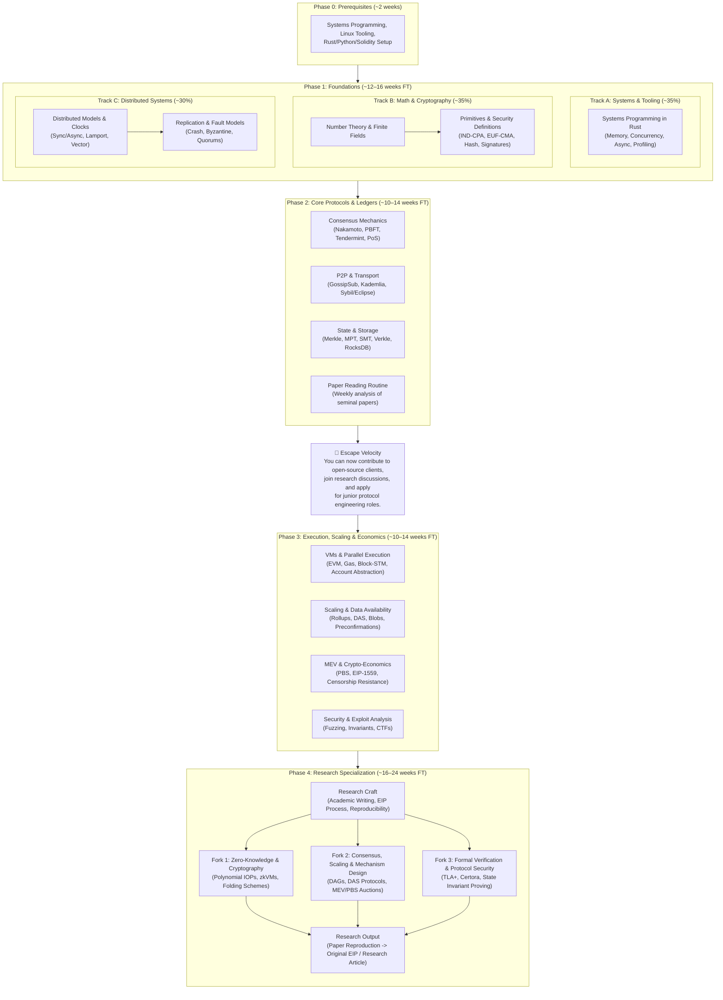

# Blockchain Research: Topics & Roadmap

---

## Curriculum Duration & Language Requirements

> **Estimated Total Duration:** ~12–18 months full-time | ~2–3 years part-time (assuming a strong CS/math undergraduate background).

> **Language Requirements:** This curriculum requires working proficiency in three languages:
> - **Rust** (primary) — systems programming, protocol implementations, all core labs
> - **Python** (secondary) — Monte Carlo simulations, statistical modeling, rapid prototyping
> - **Solidity + Foundry** (Phase 3+) — smart contract security, exploit analysis, invariant fuzzing

---

## Core Topics

### 1. Cryptography & Security Foundations
* **Foundations & Security Definitions:** Symmetric/asymmetric encryption, cryptographic hash functions (SHA-256, Keccak-256), IND-CPA, IND-CCA, EUF-CMA, random oracle model, computational vs. information-theoretic security, security reductions.
* **Digital Signatures & Identity:** ECDSA (secp256k1), EdDSA (ed25519), Schnorr signatures, BLS aggregate signatures, multi-signatures, threshold signatures (TSS/FROST).
* **Commitment Schemes & Advanced Primitives:** Vector & polynomial commitments (KZG, IPA, FRI), Pedersen commitments, homomorphic encryption, bilinear pairings.
* **Zero-Knowledge Proofs (ZKPs):** Interactive proofs, Fiat-Shamir heuristic, zk-SNARKs (Groth16, PLONK, STARKs), polynomial IOPs, folding schemes (Nova), arithmetic circuits (Circom, Noir).
* **Post-Quantum Cryptography (PQC):** Quantum threat models (Shor/Grover), lattice-based cryptography (LWE/Module-LWE), hash-based signatures (SPHINCS+), PQC migration for consensus and accounts.
* **Key References:** *A Graduate Course in Applied Cryptography* (Boneh & Shoup), *Introduction to Modern Cryptography* (Katz & Lindell), *Proofs, Arguments, and Zero-Knowledge* (Thaler).

---

### 2. Distributed Systems & Fault Tolerance
* **Core Models:** Node replication, failure models (crash-stop, crash-recovery, Byzantine), network models (synchronous, asynchronous, partially synchronous).
* **Theorems & Fundamental Limits:** CAP theorem, FLP impossibility, PACELC theorem, quorum intersections ($n \ge 3f + 1$).
* **Clocks & Ordering:** Physical clocks, Lamport logical clocks, vector clocks, causal vs. total ordering.
* **Safety vs. Liveness:** Invariant verification, state-machine replication (SMR), liveness traps, view changes.
* **Key References:** *Distributed Systems* (Tanenbaum & van Steen), *Designing Data-Intensive Applications* (Kleppmann), MIT 6.824.

---

### 3. Consensus Protocols
* **Classical Consensus (CFT):** Paxos, Raft.
* **Classical BFT:** Byzantine Generals Problem, PBFT, Tendermint Core, HotStuff, Jolteon.
* **Nakamoto Consensus (PoW):** Longest-chain rule, difficulty adjustment, mining incentives, selfish mining, 51% attacks, finality vs. probabilistic settlement.
* **Proof of Stake (PoS):** Chain-based vs. BFT-based PoS, Casper FFG/CBC, slashing dynamics, nothing-at-stake problem, long-range attacks, validator selection (VRFs, RANDAO).
* **DAG-Based & High-Throughput Protocols:** BlockDAG, GhostDAG, Narwhal & Bullshark, Mysticeti.
* **Key References:** Bitcoin Whitepaper (Nakamoto), Ethereum PoS/Casper specs, Tendermint Whitepaper, HotStuff Paper (Yin et al.).

---

### 4. Peer-to-Peer Networking & Transport
* **Transport & Discovery:** TCP/UDP, QUIC, NAT traversal (STUN/TURN/ICE), Kademlia DHT, discv5.
* **Gossip Protocols:** Flooding vs. Epidemic gossip, GossipSub (libp2p), message validation, peer scoring, propagation latency.
* **Network Attacks & Resilience:** Sybil attacks, Eclipse attacks, routing attacks, BGP hijacking, wiretap/timing analysis, network partitions.
* **Key References:** libp2p specs, devp2p specs, Stanford CS144.

---

### 5. Storage & Authenticated State Structures
* **Authenticated Data Structures:** Merkle trees, Sparse Merkle Trees (SMT), Merkle Patricia Tries (MPT), Verkle trees (vector commitments), MMR (Merkle Mountain Ranges).
* **Storage Engines:** Key-value engines (LevelDB, RocksDB), LSM-trees, B-trees, WAL (Write-Ahead Logging), compaction, write/read amplification.
* **State Models & Scalability:** UTXO vs. Account-based model, world state growth, state pruning, historical state archives, stateless validation (block witnesses, state expiry).
* **Light Client Protocols:** Sync committee proofs, header chain verification, portal network, light client bridges for cross-chain.
* **Key References:** Ethereum Yellow Paper (state trie specs), RocksDB Architecture Guide.

---

### 6. Execution Environments & Virtual Machines
* **Virtual Machine Architectures:** EVM internals (stack/memory/storage layout, gas metering, opcode schedule), WebAssembly (Wasm) runtimes, eBPF (Solana/SVM).
* **Parallel Execution:** State access conflicts, Software Transactional Memory (STM) in blockchains (Block-STM, Aptos, Sui, Monad).
* **Account Abstraction:** ERC-4337 (user operations, bundlers, paymasters, entry point contract), RIP-7560 (native account abstraction), smart accounts, session keys, social recovery.
* **zkVMs & Proving Systems:** RISC Zero, SP1, Valida, zkEVM approaches (Type 1 to Type 4).
* **Key References:** *Mastering Ethereum* (Antonopoulos & Wood), EVM Illustrated, Block-STM Paper, ERC-4337 Specification.

---

### 7. Scaling, Layer-2 & Data Availability (DA)
* **Rollup Architectures:** Execution vs. settlement vs. data availability, optimistic rollups (fraud proofs, interactive bisection games), ZK rollups (validity proofs, state diffs).
* **Data Availability Problem:** Data Availability Sampling (DAS), 2D Reed-Solomon erasure coding, KZG commitments in DA, EIP-4844 (blobs), Celestia, EigenDA.
* **Sequencing & Decentralization:** Centralized vs. decentralized sequencers, shared sequencing, based rollups, rollup-to-rollup atomic execution.
* **Preconfirmations & Inclusion Guarantees:** L1 preconfirmations, proposer commitments for inclusion, based preconfirmations, latency vs. finality trade-offs.
* **Light Client Protocols for Statelessness:** Block witnesses, state expiry, portal network, light client proofs for rollup state.
* **Key References:** *Rollup Economics* papers, Celestia Whitepaper (Al-Bassam et al.), Ethereum EIP-4844 specs, Justin Drake's *Based Rollups* (ethresear.ch).

---

### 8. Cross-Chain Protocols & Interoperability
* **Verification Models:** Light client verification, trusted relays, multi-party MPC bridges, optimistic bridges, zero-knowledge proof bridges (zk-bridges).
* **Cross-Chain Communication:** Inter-Blockchain Communication (IBC), arbitrary message passing (LayerZero, Chainlink CCIP).
* **Intent-Based Architectures:** Intent lifecycle (expression → solving → settlement), solver networks, UniswapX, Suave (Single Unified Auction for Value Expression), cross-chain intent settlement.
* **Shared Security:** Restaking mechanisms (EigenLayer, Symbiotic), mesh security.
* **Key References:** IBC Specification, SoK: Blockchain Interoperability (Zamyatin et al.), Anoma Intent Architecture.

---

### 9. MEV, Auction Theory & Mechanism Design
* **Game Theory & Microeconomics:** Nash equilibrium, dominant strategies, incentive compatibility, auction design (first-price, sealed-bid, Dutch auctions, multidimensional fee markets).
* **Crypto-Economics:** Staking economics, dynamic base fee mechanisms (EIP-1559), issuance/burn mechanics, validator penalty curves.
* **MEV (Maximal Extractable Value):** Sandwich attacks, arbitrage, liquidations, searcher-builder-proposer supply chain, PBS (Proposer-Builder Separation), MEV-Boost, PEPC (Protocol-Enforced Proposer Commitments), encrypted mempools.
* **Censorship Resistance Mechanisms:** Inclusion lists (IL), FOCIL (Fork-Choice Enforced Inclusion Lists), forced transaction inclusion, censorship resistance under regulatory pressure, committee-based inclusion enforcement.
* **Key References:** *Flash Boys 2.0* (Daian et al.), Flashbots Research, *An Introduction to Game Theory* (Osborne), Mike Neuder et al. on Inclusion Lists.

---

### 10. Security, Auditing & Protocol Attacks
* **Smart Contract & Logic Vulnerabilities:** Reentrancy, arithmetic errors, oracle manipulation, access control flaws, flash loan attacks.
* **Economic & Game-Theoretic Attacks:** Bribing attacks, validator cartel collusion, censorship games, griefing vectors.
* **Testing & Formal Analysis Tools:** Static analysis (Slither), symbolic execution (Mythril, Halmos), property-based fuzzing (Foundry/Forge, Echidna), differential testing across execution clients.
* **Security Standards:** SWC Registry, SCSVS, EthTrust.

---

### 11. Formal Verification & Protocol Modeling
* **Theoretical Principles:** Mathematical specifications, state-transition invariants, model checking, temporal logic (LTL/CTL), theorem proving.
* **Verification Tooling:** TLA+ (consensus modeling), Certora Prover, K-Framework (KEVM), Lean 4 / Coq / Isabelle.
* **Target Domains:** Consensus protocol safety/liveness proofs, core DeFi math, bridge state machines.

---

### 12. Privacy & Confidentiality
* **Mixing & Anonymity:** CoinJoin, stealth addresses, ring signatures (Monero), confidential transactions (Pedersen commitments).
* **Shielded Computation:** Zcash Sapling/Orchard, Tornado Cash, private state rollups (Aztec).
* **Hardware Enclaves (TEEs):** Intel SGX, AMD SEV, attestation schemes, TEE side-channels vs. cryptographic privacy.

---

### Phase 0: Systems Engineering & Tooling Prerequisites

> **Estimated Duration:** ~2 weeks (setup and verification of prior fluency).

These are **hard prerequisites** — do not begin Phase 1 without confirming working proficiency.

* **Systems Programming:** Rust (ownership, async/tokio, zero-copy serialization, memory layout, unsafe boundaries) or Go.
* **Node Infrastructure:** Execution/consensus client architecture (e.g., Reth + Lighthouse), RPC specs, IPC communication.
* **OS & Diagnostic Tools:** Linux profiling (`perf`, `strace`, `eBPF`), network inspection (`tcpdump`, Wireshark), benchmarking frameworks (`criterion`).
* **Verification:** You should be able to write a multi-threaded Rust CLI application that makes async network calls, serializes/deserializes binary data, and produces a flamegraph of its hot path. If you cannot, extend this phase and work through *The Rust Programming Language* before proceeding.

---

## Topic Impact vs. Learning Effort

| Topic | Impact on Research | Learning Effort | Est. Weeks | Notes |
| :--- | :---: | :---: | :---: | :--- |
| **Cryptography & Security Definitions** | High | High | 5–7 | Fundamental prerequisite for reading any crypto/security paper |
| **Distributed Systems & Consensus** | High | High | 5–7 | Core bedrock of layer-1 protocol design and safety proofs |
| **Scaling, Rollups & Data Availability** | High | High | 5–7 | Highest-velocity active academic & industry research area |
| **Zero-Knowledge Proofs (ZKPs)** | High | High | 6–8 | Essential for next-generation privacy, scaling, and zkVMs |
| **Execution Environments & VMs** | High | Medium | 3–5 | Key to parallel execution, state models, and gas optimization |
| **MEV & Mechanism Design** | High | Medium | 3–4 | Essential for economic safety, block building, and game theory |
| **Security & Protocol Attacks** | High | High | 4–6 | Bridges theory and practical attack vectors in production systems |
| **Account Abstraction** | Medium–High | Medium | 2–3 | High-velocity ERC-4337/RIP-7560 research, active EF priority |
| **Storage & State Tries** | Medium | Medium | 3–4 | Critical for statelessness, state growth, and proof verification cost |
| **P2P Networking** | Medium | Medium | 2–3 | Vital for gossip latency, eclipse resistance, and network partitions |
| **Cross-Chain & Interoperability** | Medium | Medium | 2–3 | Essential for multi-chain security models and bridge architectures |
| **Intent-Based Architectures** | Medium | Medium | 1–2 | Emerging paradigm reshaping transaction supply chains |
| **Preconfirmations & Inclusion** | Medium | Medium | 1–2 | Active research for rollup UX and L1 inclusion guarantees |
| **Censorship Resistance** | Medium | Medium | 1–2 | Critical for protocol neutrality; active EF research (FOCIL, ILs) |
| **Formal Verification** | Medium | High | 4–6 | High barrier to entry; indispensable for critical protocol invariants |
| **Privacy & Confidentiality** | Medium | High | 3–5 | Strong niche overlap with zero-knowledge and cryptographic primitives |
| **Post-Quantum Cryptography** | Medium | High | 2–3 | Future-proofing protocols; active migration research |
| **Tooling & Dev Infrastructure** | Prerequisite | Low | 2 | Practical operational skill; necessary to run experiments, not research itself |

---

## Progressive Roadmap (Parallel Tracks & Milestones)

---

### Phase 0: Prerequisites
* **Estimated Duration:** ~2 weeks.
* **Focus:** Verify working proficiency in Rust, Python, and Linux systems tooling. Set up development environment, install Foundry, and confirm you can build and run a multi-threaded async Rust application.
* **Gate Criteria:** You can write a Rust CLI that spawns async tasks, makes TCP connections, serializes binary data, and produces a flamegraph. If not, extend this phase.

---

### Phase 1: Foundations (Concurrent Tracks)
* **Estimated Duration:** ~12–16 weeks full-time | ~6–8 months part-time.
* **Focus:** Master cryptographic foundations, formal security definitions, distributed failure models, and systems programming concurrently from day one. Allocate ~35% time to Track A (Systems), ~35% to Track B (Crypto), ~30% to Track C (Distributed Systems).
* **Key Tasks:**
  * **Track A (Systems):** Attain fluency in Rust (ownership, async I/O with Tokio, concurrency primitives, benchmarking with Criterion).
  * **Track B (Crypto):** Study finite fields, elliptic curves, cryptographic hardness assumptions, and reduction proofs.
  * **Track C (Distributed Systems):** Analyze CAP/FLP limits, logical clocks, and state-machine replication invariants.
* **Milestones:** See [lessons.md Phase 1 Capstone Milestones](file:///home/nulL/Documents/reshard/lessons.md) for detailed deliverables.

#### Phase 1 → 2 Gate: You Are Ready When…
- [ ] You can implement a digital signature scheme from mathematical primitives (not just calling a library).
- [ ] You can explain why BFT requires $n \ge 3f + 1$ and CFT only needs $2f + 1$, and sketch the quorum intersection proof.
- [ ] You can build and profile a concurrent Rust application using Tokio, identify bottlenecks with flamegraphs, and reason about lock contention.
- [ ] You can state the FLP impossibility result precisely and explain what it does and does not prevent.

---

### Phase 2: Core Protocols & Systems
* **Estimated Duration:** ~10–14 weeks full-time | ~5–7 months part-time.
* **Focus:** Internal mechanics of decentralized consensus, state authentication, and peer-to-peer communication. Begin regular research paper reading.
* **Key Tasks:**
  * Compare Nakamoto longest-chain vs. classical BFT quorum safety and liveness conditions ($n \ge 3f + 1$).
  * Analyze validator selection (VRFs), Casper FFG/CBC finality, and slashing dynamics under network partitions.
  * Study authenticated data structures, proof overhead, and state storage trade-offs.
  * Read and critique seminal consensus papers (e.g., PBFT, Tendermint, Nakamoto, HotStuff).
* **Milestones:** See [lessons.md Phase 2 Capstone Milestones](file:///home/nulL/Documents/reshard/lessons.md) for detailed deliverables.

#### Phase 2 → 3 Gate: You Are Ready When…
- [ ] You can implement a multi-node BFT state machine that reaches consensus despite a Byzantine participant.
- [ ] You can construct and verify Merkle/SMT proofs and explain the proof-size trade-offs between MPT, SMT, and Verkle trees.
- [ ] You can read a modern consensus paper (e.g., HotStuff, Bullshark) and identify its network model, safety proof structure, and liveness assumptions without external help.
- [ ] You have written at least 4 structured critical evaluations of seminal papers.

---

> ### 🚀 Escape Velocity
>
> **At this point, you know enough to start contributing — not just studying.**
>
> You can now meaningfully:
> - **Contribute to open-source execution/consensus clients** (e.g., Reth, Lighthouse, CometBFT) by reading, understanding, and modifying protocol-level code.
> - **Participate in research forum discussions** (ethresear.ch, Ethereum Magicians) with informed technical opinions.
> - **Apply for junior protocol engineering or research roles** at L1/L2 teams, auditing firms, or research labs.
> - **Attend and benefit from research workshops** (e.g., SBC, Financial Crypto, Science of Blockchain Conference).
>
> Phases 3 and 4 deepen your specialization. They are not prerequisites for being useful — they are prerequisites for *leading* research.

---

### Phase 3: Execution, Scaling & Economics
* **Estimated Duration:** ~10–14 weeks full-time | ~5–7 months part-time.
* **Focus:** Virtual machine execution, modular scaling (rollups & DA), transaction supply chains (MEV), censorship resistance, account abstraction, and protocol security.
* **Key Tasks:**
  * Dissect EVM gas accounting, opcode dispatch, and parallel execution models (Block-STM).
  * Analyze rollup architectures: interactive fraud dispute bisection vs. validity proof verification; investigate the Data Availability problem, DAS, and preconfirmation mechanisms.
  * Model transaction fee mechanisms (EIP-1559), PBS auctions, and validator reward/penalty curves under adverse network conditions.
  * Study account abstraction (ERC-4337, RIP-7560) and its implications for wallet UX and transaction supply chains.
  * Analyze censorship resistance mechanisms: inclusion lists, FOCIL, and forced inclusion.
  * Conduct protocol and smart contract audits using fuzzing (Foundry) and static analysis (Slither).
* **Milestones:** See [lessons.md Phase 3 Capstone Milestones](file:///home/nulL/Documents/reshard/lessons.md) for detailed deliverables.

#### Phase 3 → 4 Gate: You Are Ready When…
- [ ] You can trace EVM bytecode execution step-by-step (stack, memory, storage, gas) and explain parallel execution conflict resolution.
- [ ] You can model an MEV extraction scenario mathematically, including searcher/builder/proposer incentives.
- [ ] You can explain the interactive bisection fraud proof protocol and why it's cheaper on-chain than single-round proofs.
- [ ] You have exploited and written post-mortems for non-trivial smart contract vulnerabilities.

---

### Phase 4: Advanced Specialization & Original Research
* **Estimated Duration:** ~16–24 weeks full-time | ~8–12 months part-time.
* **Focus:** Deep specialization into one primary domain, research craft acquisition, paper reproduction, and original research contribution.

#### Fork Selection Framework

Choose **one** primary fork. You may sample a fork for 1–2 weeks before committing. Use this decision guide:

| Criterion | Fork 1: ZK & Cryptography | Fork 2: Consensus & Scaling | Fork 3: Formal Verification |
|---|---|---|---|
| **You'll thrive if you enjoy…** | Abstract algebra, polynomial math, circuit design | Systems architecture, game theory, network simulations | Mathematical proofs, logic, exhaustive correctness arguments |
| **Strongest background needed** | Math (algebra, number theory) | Systems engineering + economics | Logic, type theory, proof assistants |
| **Career trajectories** | ZK protocol teams, proving system design, cryptographic research | L1/L2 protocol design, MEV research, scaling R&D | Auditing firms, formal methods teams, safety-critical protocol work |
| **Current research velocity** | 🔴 Very high (folding schemes, zkVMs are evolving monthly) | 🔴 Very high (DAG consensus, DAS, PBS are active frontiers) | 🟡 Moderate (growing demand, fewer practitioners) |
| **Risk profile** | High-reward/high-effort — math-heavy, steep learning curve | Broad applicability — transferable to many protocol roles | Niche but defensible — formal skills are rare and increasingly valued |

#### Specialization Forks:
* **Fork 1: Advanced Cryptography & Zero-Knowledge**
  * *Topics:* Polynomial commitment schemes (KZG, FRI), R1CS/Plonkish arithmetization, folding schemes (Nova), zkVM internals, post-quantum signatures.
* **Fork 2: Consensus, Scaling & Mechanism Design**
  * *Topics:* DAG consensus (Bullshark/Mysticeti), Data Availability Sampling (DAS), based rollups, shared sequencing, preconfirmations, MEV mitigation / PEPC, censorship resistance.
* **Fork 3: Formal Verification & Protocol Security**
  * *Topics:* Specification languages (TLA+), symbolic execution, formal verification of smart contract invariants (Certora) or consensus state machines (Coq/Lean).

#### Milestones:
See [lessons.md Phase 4 Research Production Pipeline](file:///home/nulL/Documents/reshard/lessons.md) for detailed deliverables, including:
* Literature Survey / SoK
* Paper Reproduction & Empirical Benchmarking
* Specialization Capstone
* Original Contribution (Academic Paper / EIP / Open-Source Artifact)